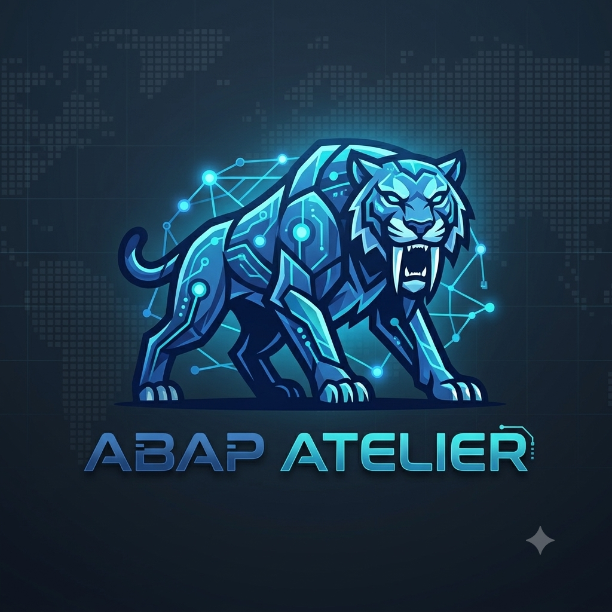
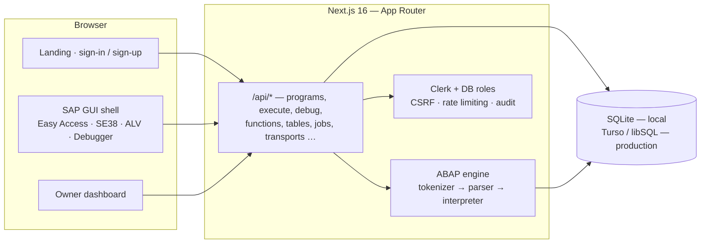

# ABAP Atelier

**A modern, browser-based SAP NetWeaver®-style ABAP training workbench.**

Write, run, debug and manage *real* ABAP in your browser — a faithful SAP GUI surface,
a from-scratch ABAP interpreter, a Modern ABAP workspace, private accounts and a 100% free cloud deployment.

**[▶ Open the live workbench](https://abap-studio.akashgupta.is-a.dev)** · [Deployment guide](DEPLOY.md)

---

## What is ABAP Atelier?

ABAP Atelier recreates the day-to-day feel of working in an SAP NetWeaver system — the logon
pad, Easy Access menu tree, SE38 editors, DDIC dictionary views and ALV grids — and runs
**actual ABAP code** through a purpose-built interpreter written in TypeScript. A dedicated
**Modern ABAP workspace** adds executable 7.40 constructor expressions plus structurally
validated CDS, RAP and AMDP artefacts, with an explicit capability matrix instead of
pretending to be a real HANA/RAP runtime.

It ships with a ready-made curriculum: **16 topics**, **47 preloaded objects**
(42 Standard examples, 1 shared include, 4 Modern), **11 demo tables** (SFLIGHT and friends,
113 rows) and function modules — so a learner can go from first sign-in to running and saving
real ABAP without an SAP system.

> **ABAP Atelier is an independent training simulator.** It is not affiliated with or endorsed
> by SAP SE, and it never claims production SAP parity — what runs, what is validated and what
> is simulated is always labelled in the product.

## ✨ Feature highlights

### 🖥️ Authentic SAP GUI surface
Standard SAP GUI for HTML chrome — `#99b7d7` title bar with the SAP logo, centered screen
title, `MER (105)` system dropdown and new-session chevron, menu bar with the OK-code field,
standard + application toolbars, dark status bar (`#333d47`) with colored messages, `INS/OVR`,
transaction, user, date and a live clock. Easy Access tree with Favorites, command palette,
real button sets, field help, dirty-state awareness and keyboard conventions (`F8` run,
`Ctrl+S` save, `Ctrl+F2` check, `/h` debug, `/nex` log off).

### 🧭 Transactions
| Transaction | What you can do |
| --- | --- |
| **SE38** | ABAP Editor: create, edit, activate, syntax-check and execute reports, includes and classes |
| **SE37** | Function Builder: groups, modules, full parameter grids, isolated test console |
| **SE11** | ABAP Dictionary: browse table definitions; the owner maintains Z*/Y* customer tables |
| **SE16N** | Data Browser: per-field criteria — `EQ NE GT LT GE LE BT CP` with `*`/`+` wildcards |
| **SE24** | Class Builder: ABAP Objects with inheritance, events and interfaces |
| **ST22** | Dump analysis: real runtime errors (`CX_SY_ZERODIVIDE`, …) as readable dumps |
| **SE80** | Object Navigator: repository-wide search |
| **SE93** | Transaction registry: customer t-codes that start reports |
| **SE91** | Message class maintenance — `MESSAGE e001(ZCLASS)` resolves stored texts |
| **SNRO** | Number ranges with `NUMBER_GET_NEXT` |
| **AL11 / CG3Y / CG3Z** | Application-server files (`OPEN / READ / TRANSFER DATASET`) |
| **SM59** | RFC destinations (simulated) |
| **SCI / SLIN** | Static code inspection of your programs |
| **SLG1 / SM21** | Application log and system log of every execution |
| **SM36 / SM37** | Background jobs with stored job logs |
| **SQ01 / SQ02** | ABAP Query that generates and executes real ABAP |
| **SE09 / SE10** | Transport organizer with STMS import queue |
| **SM50** | Work-process activity snapshot |

### ⚙️ A real ABAP engine — from scratch
A hand-written **tokenizer → parser → tree-walking interpreter** in TypeScript — not a
wrapper, not a transpiler. Procedural and object-oriented ABAP, Open SQL against demo
tables, selection screens, list and **ALV-style output**, internal tables, field symbols,
control breaks, exception classes — plus a **stateless step-by-re-execution debugger** with
line breakpoints, live variable inspection and `F5`/`F6`/`F8` stepping, and the **Pretty
Printer** (`Shift+F1`) with real keyword casing and block re-indentation.

### 🎨 Modern ABAP workspace
7.40 constructor expressions (`NEW`, `VALUE`, `FOR`, `REDUCE`, `COND`, `SWITCH`, table
expressions, inline declarations) **execute for real**. CDS view entities and RAP behavior
definitions are **validated structurally** against the simulated DDIC; AMDP classes are
simulated. The boundary is always explicit — never implied.

### 📚 A ready-made learning path
Ten classical topics plus Modern ABAP — from first `SELECT` to CDS, RAP and AMDP — each with
runnable, read-only examples you can open, study and copy into your private workspace.

### 🔐 Secure accounts and private workspaces
- **Clerk** identity: verified email one-time code or Google — password logon is retired
- Server-side sessions, same-origin CSRF checks, rate limiting, session revocation
- Private programs and Modern objects are creator-only; shared examples stay read-only
- **Owner-only administrator dashboard**: adoption metrics, 7-day execution chart, user
  masters, suspension, session revocation, confirmed deletions and a full audit log

## 🏛 Architecture

The engine is a **pure, stateless function**: it loads a DB snapshot + FMs + includes, runs,
and discards. Execution never writes ABAP table changes back to the database — the debugger
re-executes deterministically per step, so pausing can never mutate persisted rows. The
schema layer uses an **additive, idempotent migration strategy** (`CREATE TABLE IF NOT
EXISTS` + column patches) that is safe to race across serverless cold starts.

## 🧪 Testing & quality

Quality is enforced by three automated suites that run alongside lint and type checks:

| Suite | Coverage |
| --- | --- |
| **Unit** | ABAP engine, parser, table filters, provisioning logic |
| **API security** | Live-server tests — authentication, CSRF, tenant isolation, rate limiting, session revocation |
| **UI + accessibility** | Playwright end-to-end flows (public pages, SE38/SE37, debugger, dashboard) with **axe scans that fail the build on serious or critical violations** |

The deployment pipeline also includes a schema-apply workflow and a production smoke suite.

## 📜 Roadmap and explicit boundaries

Out of scope — by design, not by omission: connecting to a real SAP system, executing HANA
SQL, RAP/OData runtime, dynpro generation, production SAP parity. The simulator's value is an
authentic *training* experience with honest labels; see the in-app capability matrix.

Ideas ahead: multi-session tabs (SM04-style), more curriculum topics, dump-to-source
navigation, shared class libraries.

## Credits

Designed, built and operated by **Akash Gupta** —
[Next.js](https://nextjs.org), [Prisma](https://www.prisma.io),
[Turso](https://turso.tech), [Clerk](https://clerk.com), [Tailwind CSS](https://tailwindcss.com),
[shadcn/ui](https://ui.shadcn.com) and [react-bits](https://reactbits.dev).

© 2026 Akash Gupta. **All rights reserved.** 
This repository is shown as a portfolio showcase. No license is granted to copy, reuse or
redistribute the code or assets. 
**ABAP Atelier** is an independent training simulator — not affiliated with or endorsed by SAP SE.
SAP, NetWeaver, ABAP and SFLIGHT are trademarks of SAP SE.

